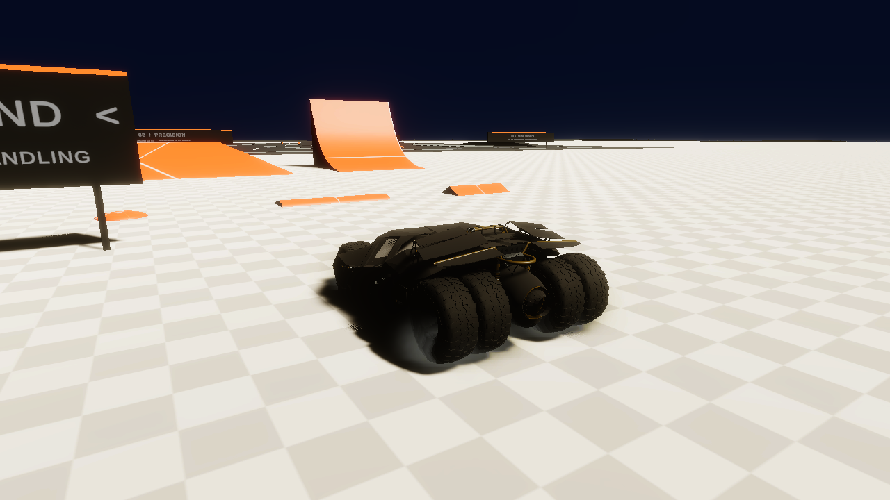

# Burnout on main

Hold **W + S** (or Up + Down), or hold **both Xbox triggers above 50%**. The combination is read independently from each device because the normal signed throttle axis cancels opposite directions. Existing action IDs/bindings and ordinary reverse/braking remain unchanged.

Entry requires a grounded vehicle at rest (under 0.02 m/s linear speed and 0.02 rad/s angular speed, allowing numerical rest jitter). As explicitly requested, rest is required **only to enter**: keep both inputs held to continue while steering or moving. Release either direction to stop. Losing every ground contact, resetting, disabling the controller or blocking gameplay input cancels the state; release the combination before restarting after reset/airborne cancellation.

FWD powers and smokes the two front tires; RWD the four rear tires; AWD all six. Every wheel separately requires a current WheelCollider ground hit to reduce driven grip and emit burnout smoke. Existing drift/braking effects remain separate outside burnout. Emitted particles dissipate normally after contact loss; no new ones are emitted from airborne wheels.

During burnout the controller supplies forward drive, reduces driven longitudinal grip, and releases the non-driven brake hold with steering. Rear lateral grip is relaxed while turning, including the non-driven rear axle during FWD pivots. No motor torque or burnout smoke is applied to a non-driven tire. Steering generates yaw through native tire/contact forces, without artificial yaw torque, frozen body axes, position corrections or body velocity clamps. AWD may creep forward because there is no non-driven axle to hold it. Wheel RPM drives the engine-RPM signal during burnout, with a torque taper near redline.

The established rear smoke systems were inactive in the scene. They are configured and enabled at runtime with automatic emission disabled; the established settings/material are cloned for the front tires. All smoke uses manual contact-based emission in world space. `TumblerEffects.burnoutSmokeRate` controls density (60 default; 18 for ordinary skid effects). The scene, colliders and approved impact correction are unchanged.

`TumblerBurnout` is a controller-owned helper, not a new scene component. Its grip-value changes restore on exit and preserve tire stiffness, so existing WheelSurfaceGrip material multipliers continue to work. ResetTransmission cancels burnout. The independent Editor-only `BurnoutVerify.Run` checks entry/release, airborne rejection, FWD/RWD/AWD contact selection, keyboard/Xbox combinations, measured steering in both directions, and actual particle emission on 2/4/6 tires with no airborne emission.

To reproduce while this checkout is closed in Unity:

```sh
/path/to/Unity -batchmode -nographics -projectPath "$PWD" -executeMethod BurnoutVerify.Run -logFile TestResults/burnout.log
python3 tools/verify-tumbler-update.py --unity /path/to/Unity
```

Native results are recorded alongside this document. The steering check integrates yaw for five seconds in each mode/direction; it verifies physical turning, not a guaranteed circular radius or a completed 360-degree turn. Visual appearance/density and physical Xbox driving should also be checked interactively on the target PC.

Validation in Unity 6000.6.7f1: **26 native burnout checks passed** (including actual smoke emission), plus **82 edit / 119 runtime regression checks**. Final five-second yaw observations are approximately ±121° FWD, ±148° RWD, and ±283° AWD. See [burnout-validation.json](burnout-validation.json).

## HDRP smoke rendering correction

The previously reused `SmokeLight` material points to a legacy built-in particle shader, producing magenta quads under HDRP. Particle-count checks did not detect this render failure. It is replaced on all six tire emitters with `Resources/TireSmokeHDRP.mat`, referencing the project-local `Tumbler/Tire Smoke HDRP` shader. The Resources material reference includes the shader in builds; no manual scene reassignment or runtime Shader.Find fallback is needed.

The shader uses HDRP transforms, transparent alpha blending, vertex color/lifetime alpha and a procedural soft circular cloud edge. It writes no depth. Explicit billboard vertex streams, a zero pivot, 0.35–0.65 m starting size, 1.4–2.2 s lifetime, gradual growth/fade, slow upward drift and a 256-particle per-wheel budget replace inherited legacy settings. Legacy flipbook, size-by-speed, color-by-speed, force, noise and trail modules are disabled to avoid unexpected huge cards or invalid UVs. Screen-size limiting further prevents individual particles from filling the view.

`SmokePreview.Run` creates/validates the material, emits real particle systems and renders Sandbox through HDRP on the GPU. It checks shader support/compilation, nonzero particles, six assigned emitters and absence of bright magenta pixels in the captured frame. Preview fixtures/cameras/exposure are not saved to the scene. Final correction validation: **28 native burnout checks passed**, plus the native HDRP GPU render. The earlier 201 controller/drivetrain regression checks remain unchanged by this rendering-only update.


