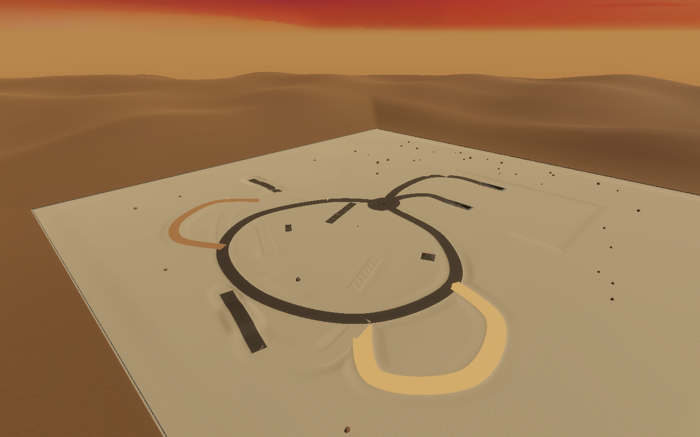
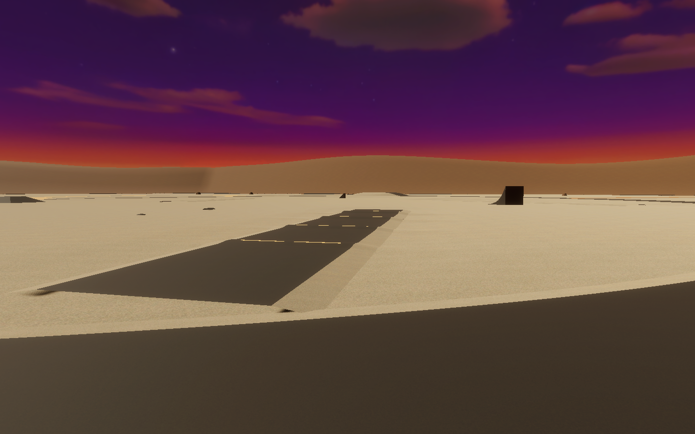
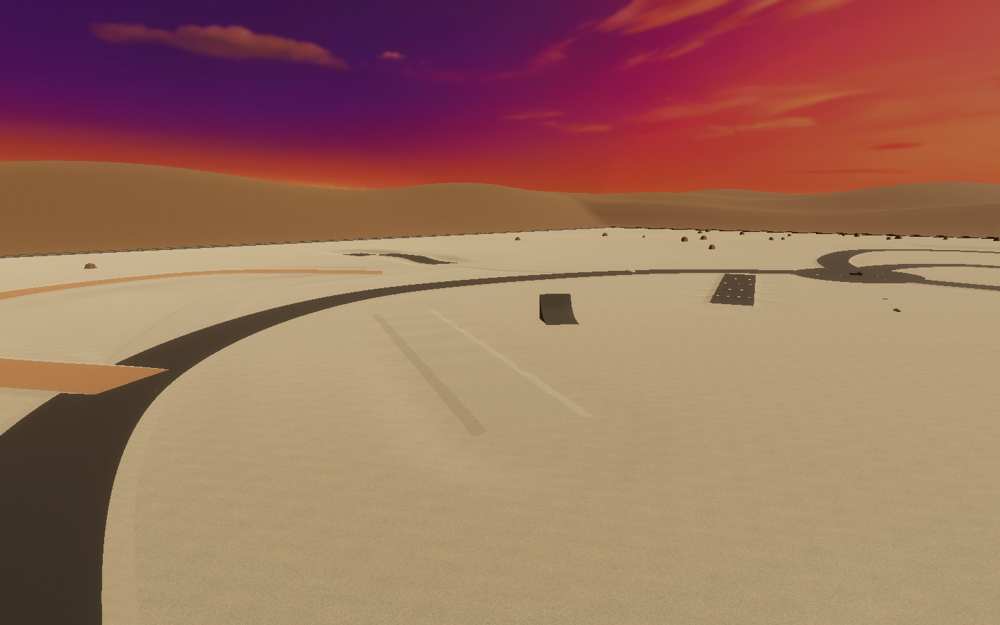

# Classic flowing proving grounds

This guide records the earlier `41632d8` layout and its historical validation. The active prefab was subsequently simplified: see [current minimal playground and validation limits](../minimal-playground.md). Use `python3 tools/minimal-playground/check.py` for current asset-preservation checks. The traversal helper below now samples only retained routes.

The current Sandbox restores the earlier style of vehicle playground under the unchanged Sky12 sunset. It has one tunnel: the original underground light lab, with its original roadway, roof, portals, lights and close-camera zones. The additional winding tunnel, deathloops and caged oval are absent from the active map.

A broad open circuit connects the spawn, the tunnel approaches, gravel, dirt and sand. The terrain has mild relief and graded road edges. Original ramp and bump models sit at varied positions and angles with clear approaches and open landing space. Guidance uses flush painted marks; freestanding instruction boards remain hidden.

| Trial | Location in X/Z | Details |
| --- | --- | --- |
| Original tunnel | Mouths (100,-40) and (242,-40) | Original approximately 460 m route; both approach roads meet the mouths |
| Progressive speed bumps | From (-40,85), heading west/southwest | Four smooth humps, 0.16 / 0.24 / 0.32 / 0.42 m high, spread along a 100 m lane |
| Alternating wheel articulation | From (-245,-115), heading east/northeast | 90 m gravel trial with left/right alternating relief |
| Rolling gravel and shallow hollows | From (-270,35), heading north/northeast | 105 m rolling suspension lane |
| Low tabletop | From (-110,230), heading north | 120 m continuous approach, 2.3 m crest and broad landing |
| Medium tabletop | From (-390,-120), heading north/northeast | 120 m continuous approach, 4.2 m crest and broad landing |
| Original ramps | Near (-282,-48), (-202,82), (-102,-124) | Original 45-degree, curved and square ramp models |
| Original bump models | Near (-82,15), (-108,8) | Rounded and triangular obstacles in the open maneuvering area |
| Dirt and sand routes | Northwest / southwest | Gentle curves with the matching per-wheel grip profiles |

The new terrain retains the original tunnel portal holes. The current sky, lighting profile, original tunnel source prefab and vehicle geometry/physics settings are preserved. The old map assets remain in the repository as inactive source material; the scene changes only the existing proving-ground prefab reference and its root/component targets.

The editable map is `Assets/_Project/Environment/ClassicSandbox/ClassicSandbox.prefab`. Terrain, road meshes, route samples and restored obstacle instances are authored assets. No procedural map generator runs during gameplay. Tire grip uses the existing `WheelSurfaceGrip` and `TerrainDrivingSurface` services. Airborne attitude remains natural, without stick control; held LB rear view and landing damping are retained.

## Verification

Run against a closed disposable checkout using Unity 6000.6.7f1:

```sh
python3 tools/classic-sandbox/run.py ClassicVerify.Run
python3 tools/classic-sandbox/run.py ClassicFixes.Run
python3 tools/classic-sandbox/run.py ClassicPreview.Run --graphics
python3 tools/flight-controls/run.py FlightFeatures.Run --graphics
python3 tools/flight-controls/run.py FlightRearMotion.Verify --graphics
python3 tools/flight-controls/run.py FlightVerify.CompareDefaultStep
python3 -m unittest discover -s tools/tests -v
python3 tools/classic-sandbox/check.py
```

`--project /path/to/disposable-copy` selects an isolated project; `--unity /path/to/Editor/Unity` selects the Editor. Temporary C# helpers are removed after each run. The shared runner refuses an open project and restores pre-existing TMP/HDRP resources.

Geometry checks sample road colliders, normals and terrain intersections. The traversal checks use the actual six-wheel Rigidbody, steering, motor/brake torque and suspension. Only the initial pose and speed are seeded; a temporary driver supplies controls without teleporting, attaching or forcing the car along a rail. Its settling fixture restores the original inertia before driving. The original-tunnel trial includes the complete exit portal and the return approach.

The landing comparison includes 5 m and 10 m drops at rest and 72 km/h. Rear-view motion checks run normal interpolation with 0.02 s physics and simulated render scheduling at 30/60/120 Hz; these are correctness checks, not GPU benchmarks. See `validation.json`, the drive traces and [review fixes](review-fixes.md). Standalone builds, physical-controller acceptance and a performance profile remain separate.

For explicit authoring in a disposable checkout, `ClassicSandbox.Build` creates a new asset folder and `ClassicSandbox.Rebuild` updates that generated folder while retaining asset GUIDs. `tools/classic-sandbox/patch_scene.py` replaces only the existing proving-ground instance. Inspect the generated scene and asset diff before retaining an authored result.






