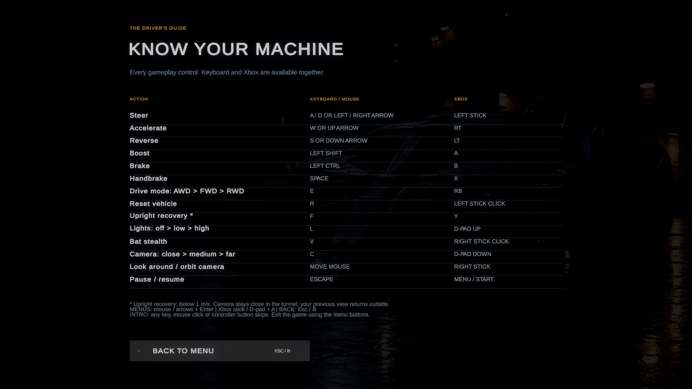
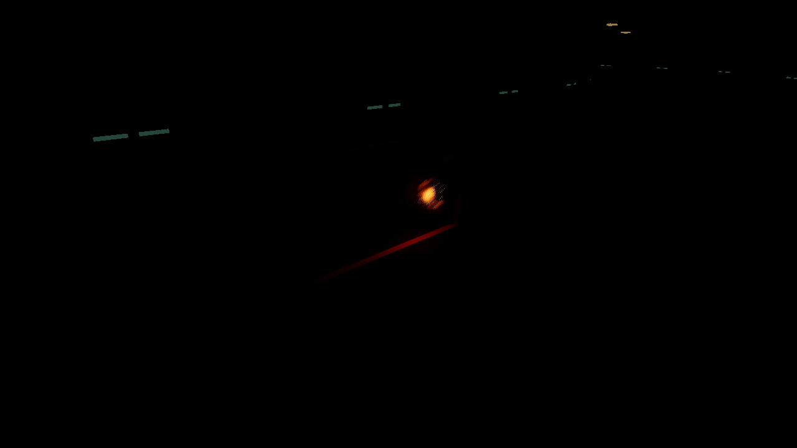
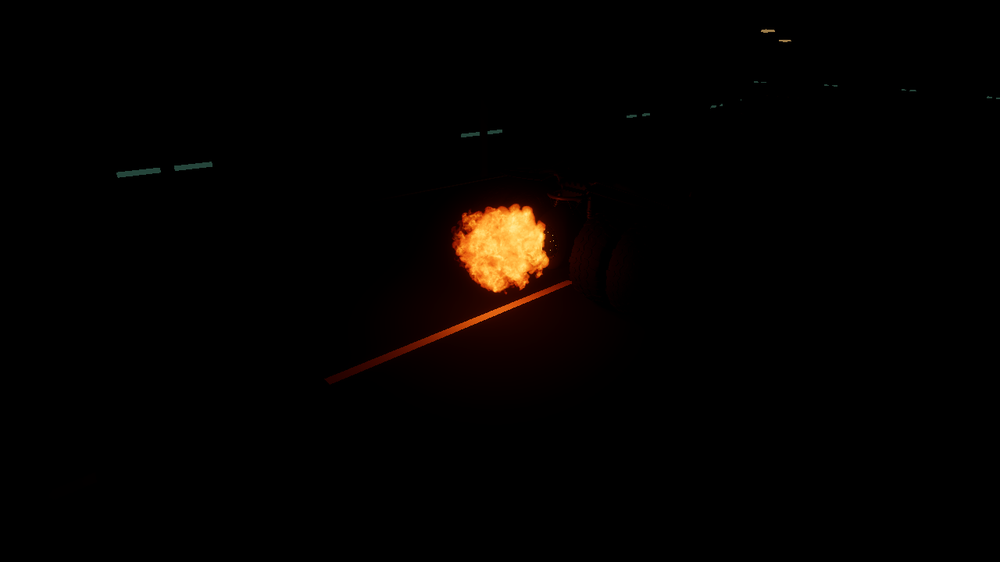

# Complete controls and turbine illumination

The Main Menu **Controls** button now opens a complete, three-column guide for
keyboard/mouse and Xbox. Its fourteen gameplay rows include lights, stealth,
camera distance, camera orbit and pause, alongside every existing driving action.
The [catalog](controls-catalog.json), baked scene labels and
[README table](../README.md#controls--xbox-and-keyboard) are checked together.

Use **C / D-pad Down** for close → medium → far; move the **mouse / right stick**
to orbit. The tunnel still forces close and restores the previous view outside.
Use **L / D-pad Up** for lights and **V / right-stick click** for stealth.

The page also explains recovery's speed limit, intro skipping and menu navigation.
The existing Back button works with **Escape / Xbox B**, selects itself when the
page opens, and restores focus to Controls on return. The page scales to the
available canvas with a margin; native captures check all 52 text elements at
1920×1080, 1280×720, 2560×1080 and 1280×960.



## Light from the flames

`TurbineFireLighting` follows the actual `Engine/NormalFire` emitter and the existing
Boost flame emitter. Two warm, soft-shadow point lights illuminate nearby surfaces:

| Source | Nominal full strength | Reach | Appearance |
| --- | --- | --- | --- |
| Normal flame | 450 lm | 3.6 m | Soft amber glow behind the nozzle |
| Turbo flame | 2400 lm | 7 m | Stronger orange glow reaching farther into the tunnel |

Strength follows the current flame particle count, eases toward its target and
has subtle ±10% flicker. Releasing turbo retains light while its remaining flame
particles dissipate. Smoke and embers do not create light. Stealth extinguishes
both sources immediately; leaving stealth restores only flames that are visible.
Pause freezes the glow and flicker with the particles. Disabling the component
clears both lights.

The two sources use 256-pixel shadow maps and finite ranges. There are no lights
per particle. Driving, gearing, boost force/reserve/recharge, headlights and
existing flame settings are retained. Packages and project settings are unchanged.
Only the controls subtree changes in Main Menu; Sandbox gains a vehicle lighting
child and its references. The preservation checker compares all other scene
documents and 1,334 existing asset/configuration files against commit `403f4ff`.

The following captures use the same tunnel viewpoint with headlights off and
the normal Sandbox exposure. They show actual Play Mode HDRP illumination:





## Repeat the checks

Close this project in Unity before running native checks. Use the project's exact
Unity **6000.6.7f1** Editor; the helpers temporarily install Editor scripts and
restore the dynamic TMP font afterward. Replace the example Editor path below.

```sh
python3 tools/verify-navigation.py
python3 tools/sandbox-expansion/check.py
python3 tools/controls-lighting/run.py ControlsLightingVerify.Run --unity /absolute/path/to/Editor/Unity
python3 tools/controls-lighting/run.py ControlsLightingPreview.Run --graphics --unity /absolute/path/to/Editor/Unity
python3 tools/controls-lighting/run.py NightSystemsVerify.Run --unity /absolute/path/to/Editor/Unity
python3 tools/verify-tumbler-update.py --unity /absolute/path/to/Editor/Unity
python3 tools/verify-navigation.py --unity /absolute/path/to/Editor/Unity
```

Reports go to ignored `TestResults/ControlsLighting`, `NightSystems`,
`TumblerUpdate` and `Navigation`. The preview helper also writes four UI captures
and idle/turbo/stealth captures. For each flame state it renders a second image
in the same frame with the two point lights disabled; image differences confirm
the added illumination rather than merely a bright flame texture.

The [validation record](controls-lighting-validation.json) separates native
controls/fire assertions, existing gameplay regressions, layout checks and visual
evidence. The tests use virtual Xbox/keyboard input in real Play Mode. Physical
controller acceptance, standalone Windows/Linux execution and performance
profiling remain manual checks. No release, tag or build publication is added.

For intentional UI authoring, `ControlsLightingAuthoring.Build` generates expanded
scene copies under TestResults. `tools/controls-lighting/apply.py` applies only
approved controls objects and lighting additions to the original scene baseline;
it is an authoring utility, not required to play or validate the project.
