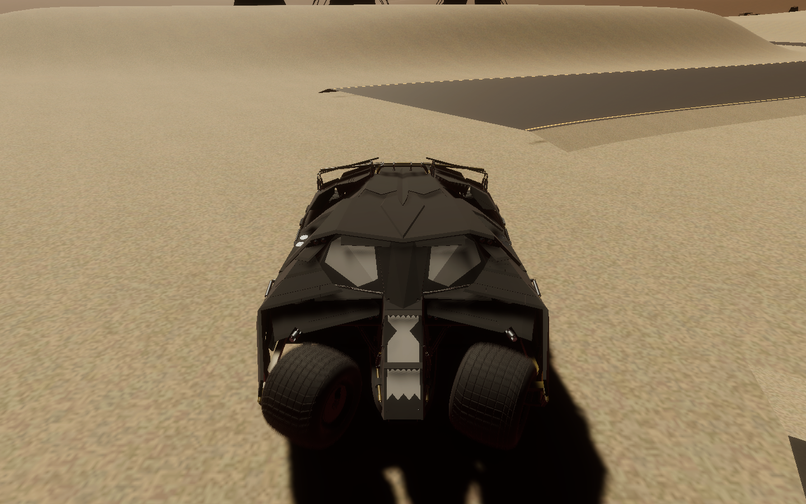
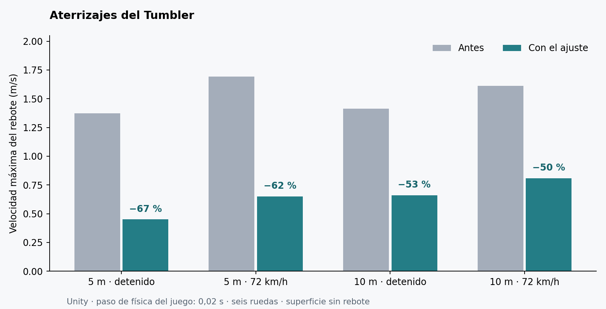

# Flight control, rear view and landing absorption

The Tumbler can now be oriented in a jump with the left stick. Up points the nose down, down raises it, and left/right rolls the vehicle. Hold X (handbrake) to use horizontal stick motion for yaw instead. Keyboard W/S/A/D or arrow keys provide the same flight control, with Space as the yaw modifier. Pitch and roll can reach any attitude; releasing the input brakes angular motion instead of automatically rotating the car upright.

Air control starts after 0.10 seconds without wheel or body contact. A single supported wheel or chassis/roof collision blocks the aerial torque. Angular acceleration and target angular rates are bounded. Pause, disable, reset and teleport clear the flight/landing state. Ground steering, gearbox, throttle, boost, speed governor, mass, center of mass and inertia are retained.

Hold **LB** (keyboard **B**) to look behind. The camera sits in front of the car at 5.8 m horizontal distance and 2.9 m height, matching the close chase view. Release to restore the previous close/medium/far preset and orbit. The same collision probe keeps this view outside walls. Tunnel proximity still takes precedence over returning to a distant preset.

The six suspension dampers now use their own supported mass to reach a 0.95 damping ratio. Spring stiffness, suspension travel, ride height and wheel geometry are unchanged. A heavy, upright touchdown on at least three wheels arms a short 0.8 second settling window. During supported contact it removes only excess velocity away from the ground normal; tangential momentum and airborne motion remain free. It does not glue the vehicle to a surface, add an automatic upright rotation or add a special loop force. Disabling the controller restores the original spring settings.

## Native validation

Unity 6000.6.7f1, HDRP 17.6, real six-wheel Rigidbody/WheelCollider simulation and virtual Input System devices were used in an isolated copy because the user's Editor was open. The committed Sandbox scene is unchanged by this feature. The only scene edits update the Controls overlay, which is checked at 1920×1080 and 1280×720.

`baseline-drops.json`, `after-drops.json` and their CSV traces record the before/after landing measurements on a solid, zero-bounce test floor. Cases include 5 m and 10 m drops at rest and at 72 km/h, plus a tilted 7.5 m drop at 54 km/h. Rebound excursion is measured from maximum suspension compression to the subsequent upward excursion; it is not an estimate of extra jump height above the standing vehicle.

The baseline was measured before the feature source was installed. A native comparison requires rebound speed below 60% of baseline, rebound excursion below 75%, an upright finish and settling within 1.3 seconds. At the project's normal 0.02 s physics step, four additional before/after pairs compare the services disabled/enabled on 5 m and 10 m drops at rest and at 72 km/h. Hard-body contact callbacks remove the solver's residual outward impulse within the same landing window; the existing depenetration limit stays unchanged. Separate input tests exercise pitch, roll, yaw, neutral stopping, grounded/roof exclusion, pause, LB hold/release, saved orbit/preset restoration, keyboard equivalents and collision protection. The original transmission, HUD and navigation tests remain part of validation.

Run on the exact Editor, while that checkout is closed in Unity:

```sh
python3 tools/flight-controls/run.py FlightVerify.Verify
python3 tools/flight-controls/run.py FlightFeatures.Run --graphics
python3 tools/flight-controls/check.py
```

The drop comparison reads the recorded baseline from this guide when `TestResults/Flight/baseline-drops.json` is absent. Editor helpers are temporary and do not ship in the player. See `validation.json` for completed checks and limits; a standalone player build and a physical controller acceptance pass are separate.




