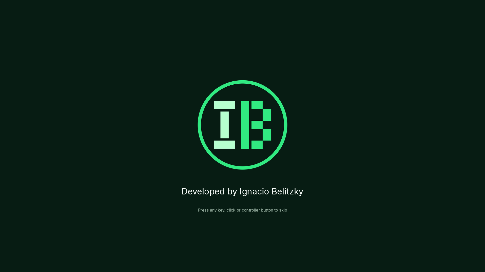

# Navigation and Phosphor introduction

Status: implementation prepared on `feat/navigation-branded-intro-release`, awaiting native Unity validation. Do not treat the static checks or the layout reference below as a successful Play Mode test. The feature must pass the checks below before merging; release work has not started.

## Player flow

`Intro → Main Menu → Sandbox → Pause → Main Menu`

The enabled scene list starts with `Assets/_Project/Scenes/Intro.unity`. Starting Main Menu or Sandbox directly in the Editor continues to work. Returning from Sandbox loads Main Menu directly and does not replay Intro.

| Context | Action | Result |
| --- | --- | --- |
| Intro | Wait about 3.6 seconds | Fade to Main Menu once preloading is ready |
| Intro | Keyboard, mouse or gamepad button after 0.45 seconds | Skip with a short fade once preloading is ready |
| Main Menu | Enter Sandbox | Load the driving scene |
| Sandbox | Escape or Xbox Start/Menu | Open pause |
| Pause | Escape or Xbox Start/Menu, or Resume | Resume after confirmation buttons are released |
| Pause | Main Menu | Unload Sandbox; reset time, audio and cursor for the menu |
| Main Menu Exit / Pause Exit Game | Explicit exit | Stop Editor Play Mode or call `Application.Quit()` in a Player |

Mouse, keyboard arrows/Enter, Xbox D-pad/stick and A operate the pause buttons through uGUI and `InputSystemUIInputModule`. Selected buttons use the existing menu's warm accent. Opening pause selects Resume. Clicking the background cannot leave keyboard/gamepad navigation without focus. The Main Menu's Controls and Back to menu callbacks retain their original serialized wiring; only the outdated `Quit sandbox` controls-table label changes to `Pause / resume`.

## Pause ownership and input

`GameNavigation` owns explicit scene changes and application exit. Its Editor API reference is compiled only inside `#if UNITY_EDITOR`. `GameManager.TogglePause` replaces the old quit callback in Sandbox.

The Input System action is still named `Gameplay/QuitGame` internally. Keeping its name, ID, bindings and generated wrapper avoids a needless regeneration; its scene callback now routes it to pause. The `.inputactions` and generated `Input.cs` are unchanged. A future action rename must use the installed official Input System generator.

One scene-local `PauseMenuController` on GameManager builds the overlay and creates an EventSystem only if Sandbox has none. It has no persistent root. The UI module is active during pause and its previous enabled state is restored on resume. Vehicle input wrappers remain enabled so their lifecycle cannot reset lights/stealth, but their input consumers and the reset, flip and drivetrain callbacks are blocked while paused. Physics uses `Time.timeScale = 0`; audio uses `AudioListener.pause`. Both values, cursor visibility and cursor locking are snapshotted and restored. Driving input is refreshed before the next physics step.

Resume waits for Enter/Space/A/Start/Escape and the mouse confirmation button to be released. This avoids a UI confirmation becoming turbo or handbrake. Entering Sandbox also waits for a held menu confirmation to be released. There are no changes to torque, gearing, steering, wheel colliders, suspension, materials, cameras or HDRP settings.

## Presentation

Intro builds a screen-space Canvas, a square 420 × 420 logo, and TextMeshPro labels with a 1920 × 1080 reference layout and a balanced width/height scale. It uses the supplied primary PNG with its existing outer protection and dark disc, Inter Regular, background `#071C13`, signature `#F5FAF7` and secondary text `#A8C0B1`. The text is exactly **Developed by Ignacio Belitzky**. See [source paths and hashes](navigation/brand-sources.json).

The content fades in over 0.6 seconds, remains visible until at least 3 seconds or a valid skip, then fades out over 0.6 seconds. The next scene preloads during the presentation; the brand remains visible when loading takes longer. The fade and skip cooldown use unscaled time. The font atlas is created locally from the original TTF and released with the scene. No new packages are required.



This is a layout reference composed from the exact source logo/font and planned uGUI coordinates. Native color, font/shader rendering, transitions and responsive layout still require checks in Unity and the Player.

The built-in Unity splash settings remain enabled. The installed Editor/license could not be inspected in this execution environment, so no license-dependent setting was changed. Review Splash Image settings with the actual license before deciding whether to suppress the additional native splash. Company and product metadata are updated to Ignacio Belitzky / Tumbler Sandbox. Version `0.1`, empty application identifiers, 1920 × 1080 defaults, fullscreen settings and icons retain their existing values until actual Player validation.

## Repeatable verification

Static preservation and reference checks need Python 3 and Git:

```sh
python3 tools/verify-navigation.py
```

Use Unity **6000.6.7f1** with this project closed in the Editor to run the native batch checks:

```sh
python3 tools/verify-navigation.py --unity /absolute/path/to/6000.6.7f1/Editor/Unity
```

To also compile a development Player for the first-phase smoke check, install the matching build module and add one target:

```sh
python3 tools/verify-navigation.py --unity /absolute/path/to/Editor/Unity --build-target Linux
python3 tools/verify-navigation.py --unity /absolute/path/to/Editor/Unity --build-target Windows
```

The helper installs a temporary Editor verifier, exercises actual scenes with virtual keyboard/gamepad input, checks both explicit exits in separate Play Mode sessions, and removes its temporary files afterward. It restores the existing dynamic default font asset and detects unexpected scene writes. The build helper compiles the enabled scenes under ignored `Builds/NavigationSmoke/`. Compilation alone does not validate the executable. Reports live under ignored `TestResults/Navigation/`; retain logs if a check fails. The baseline commit is fixed in the verifier; use a clone containing that commit.

### Required manual/native checks before merge

- Run both the native navigation verifier and an appropriate existing vehicle regression verifier, such as `tools/verify-tumbler-update.py` with the exact Unity executable.
- In Play Mode, inspect Intro at 16:9, 4:3, ultrawide and portrait sizes; verify original logo colors, margin, font rendering, fades, natural completion and keyboard/mouse/controller skip.
- Test Main Menu Controls → Back, then Enter Sandbox → Escape/Start → Resume → pause → Main Menu → Sandbox repeatedly.
- Use mouse, keyboard, Xbox stick and D-pad to select each pause button. Verify visible focus and both Exit buttons. Verify Escape/Start alone never exits.
- While paused, attempt driving, turbo, reset, flip, drive mode, lights and stealth. Resume while controls were held/released and confirm no accidental turbo/handbrake activation or stale throttle.
- Verify the physical Xbox controller when available; virtual input does not establish hardware support.
- Run a standalone smoke build on an HDRP-capable machine. Inspect shaders, textures, text, sound, driving and the Player log. Do not infer a working Player from successful compilation.
- Confirm no Console errors, missing scripts, duplicate EventSystems, leftover Sandbox objects, stuck time scale or audio pause. Review the final diff before integrating.

## Current evidence and release gate

### Changed files

| Area | Files |
| --- | --- |
| Navigation and exit | `Assets/_Project/Scripts/Core/GameNavigation.cs` (new), `GameManager.cs`, `Assets/_Project/Scripts/UI/MenuController.cs` |
| Pause and intro UI | `Assets/_Project/Scripts/UI/PauseMenuController.cs`, `IntroController.cs`, `RuntimeMenuUI.cs` (new, with `.meta` files) |
| Vehicle pause gates | `Assets/_Project/Scripts/Vehicle/Tumbler/TumblerController.cs`, `Boost.cs`, `TumblerSystems.cs`, `EngineAudio.cs` |
| Scenes | `Assets/_Project/Scenes/Intro.unity` and its `.meta` (new), `Main Menu.unity` (help label), `Sandbox.unity` (pause component/callback) |
| Original brand resources | `Assets/_Project/Art/Branding/Phosphor/` containing the original PNG, Inter Regular, OFL, provenance, usage README and metadata; parent folder metadata |
| Settings | `ProjectSettings/EditorBuildSettings.asset` (Intro first), `ProjectSettings/ProjectSettings.asset` (company/product only) |
| Verification | `tools/verify-navigation.py`, `tools/navigation/NavigationVerify.cs` (new) |
| Documentation | `README.md`, this guide, `docs/navigation/brand-sources.json`, `validation.json`, `intro-layout-reference.png` |

See [validation record](navigation/validation.json). Static asset/reference preservation, byte identity against the supplied kit and C# syntax parsing ran in this task. This Linux execution container has no Unity Editor, Unity build modules or native graphical test environment. Unity compilation, Play Mode, native HDRP rendering, physical controller checks and Windows/Linux Player compilation/execution are **not run**. No merge, version tag or Release is authorized by these static results alone under the task's validation gate.

Phase 2 remains blocked until phase 1 passes and is integrated into `main`. No release workflow, tag, download link, binary package or checksum of a nonexistent build has been created. The separate existing licensing gap also remains: provenance/redistribution permissions for Gridbox, Particle Pack, models, sounds and other assets are not fully established in the repository. The new Inter font includes its OFL; this does not resolve other assets' permissions. Review original grants before public binary distribution. No legal clearance is claimed.
