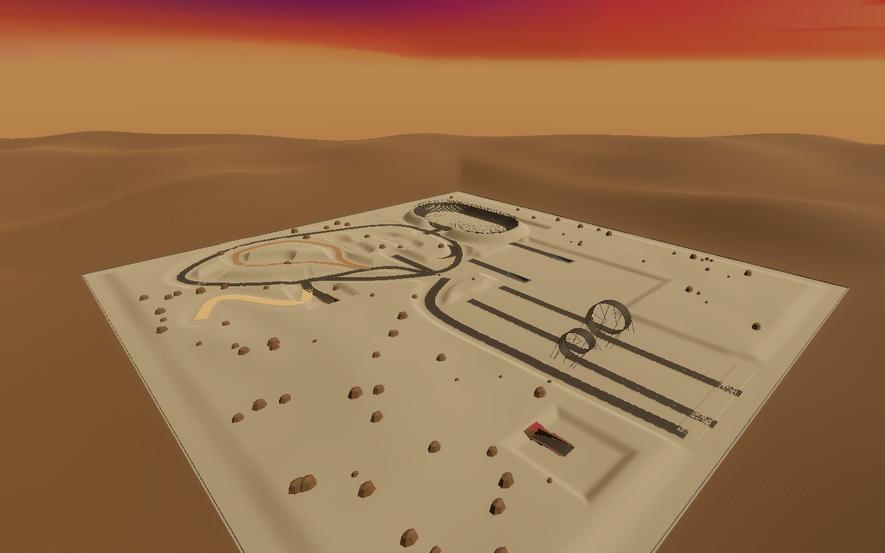
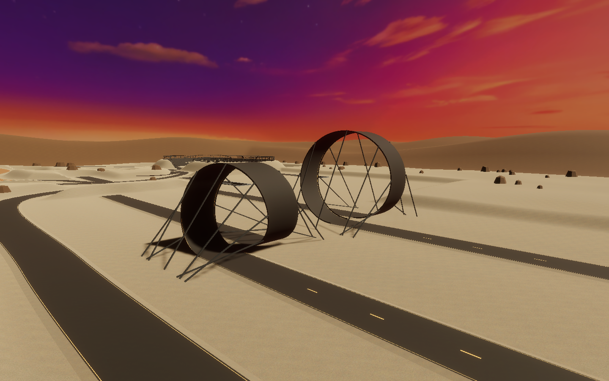
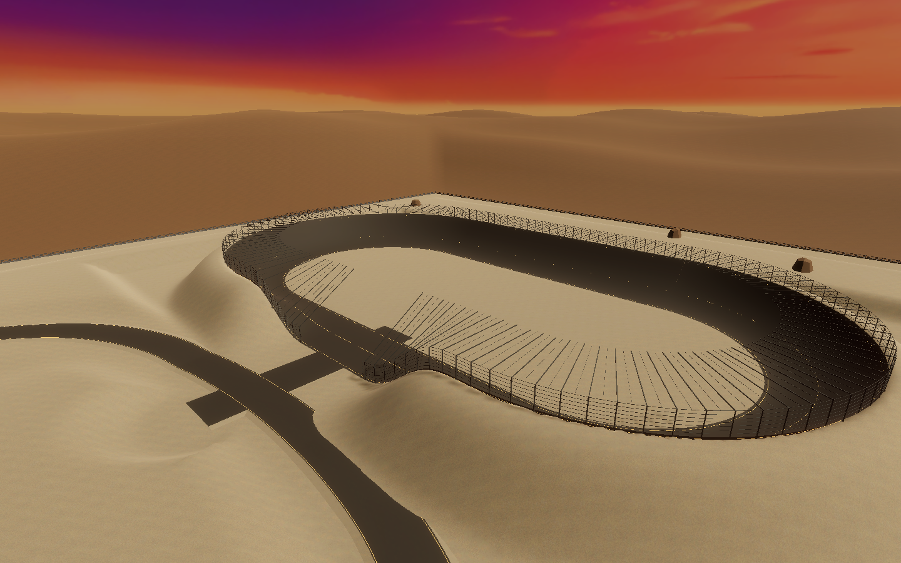

# Organic proving grounds — historical layout

This two-tunnel stunt layout is retired from the active scene. The current [classic flowing proving grounds](../classic-sandbox/README.md) keeps the original tunnel, restores the earlier ramps and adds progressive speed bumps and suspension trials. These source assets and measurements remain available for history and comparison.

Sandbox is a sculpted desert proving ground under the supplied Sky12 sunset. A flowing asphalt circuit links the central spawn to limestone, ochre dirt, soft sand, rolling suspension trials, two smooth tabletops and a shallow handling bowl. Low sandstone formations and distant ridges replace the flat checkerboard presentation. Guidance is painted on the road; the old freestanding boards and isolated obstacle displays are disabled.

The original underground light lab remains in place, with its original roadway, roof, lights, portals, local lighting and camera zones. Its instruction boards and portal sign posts are hidden through scene overrides. The new terrain retains the original portal holes.

## Routes

| Trial | Location / approach | Geometry |
| --- | --- | --- |
| Original tunnel | East from spawn; mouths at X=100 and X=242, Z=-40 | Original approximately 460 m route, unchanged |
| New winding tunnel | West from spawn; north mouth (-210,110), south mouth (-210,-390) in X/Z | Approximately 592 m, four alternating bends, 17 m road, 8.1 m central roof clearance; gradual ramps to -14 m |
| Small deathloop | Southern straight, X=-56 entry, Z=-290 bottom | 18 m radius, 16 m width, 185 m straight run-up |
| Large deathloop | Southern straight, X=24 entry, Z=-290 bottom | 26 m radius, 16 m width, 185 m straight run-up |
| Banked oval | Northeast, center (270,245); west access at Z=245 | 68 m bend radius, 140 m straights, 28 m running width, approximately 707 m centerline |
| Dirt ridge | Northwest hills | Winding climb and descent |
| Suspension / sand | Northwest | Rolling gravel and broad sand curves |
| Tabletops | North of spawn, around (-45,280) and (55,240) | Continuous 90 m approach/crest/landing profiles, 3.5 m and 6 m nominal rises |

Drive north along each southern runway to enter its loop. The loop winds sideways by 22 m across the complete turn, separating entry and exit running surfaces. The exit straight continues north for 215 m. Geometry does not attach the car, rotate it along a rail, change gravity or add a loop-specific speed/force assist during gameplay.

The oval progressively banks from a flat inner edge to roughly 33 degrees at its center and 52 degrees near the outer edge. A continuous outer collision net and overhead catch surface accompany the visible steel lattice. A broad west access opening lowers the banking gradually; the opening is intentional, so containment is not closed at the gate. Enter through the ground-level west connector, then join the oval in either direction.

C / D-pad Down still chooses the camera preset. Both tunnels temporarily use close view and restore the selected preset on exit, reset or removal of the added zone group. Headlights and stealth controls remain unchanged.

## Tire surfaces

The existing `WheelSurfaceGrip` service still scales the existing wheel friction. Asphalt uses the original grip. Gravel, dirt and sand have separate profiles. On terrain, cached painted-layer weights blend the actual grip at each wheel's contact point. No alpha-map readback or per-frame allocations are required for this sampling.

| Painted terrain layer | Forward / sideways multiplier |
| --- | --- |
| Limestone gravel | 0.78 / 0.68 |
| Ochre dirt | 0.67 / 0.55 |
| Sandstone | 0.92 / 0.85 |
| Soft sand | 0.54 / 0.46 |

## Assets and maintenance

The new content is editable in `Assets/_Project/Environment/OrganicSandbox/OrganicSandbox.prefab`. Its terrain, textures, materials, road/shell meshes and route samples are source assets. There is no runtime procedural construction. The original terrain, old obstacle prefabs, vehicle, powertrain, input, audio and UI assets are retained. The scene disables the replaced terrain/display instances and adds the new prefab, rather than deleting those source assets.

`SandboxTunnelZones` adds covered route volumes to the existing camera service. `TerrainDrivingSurface` adds terrain-layer sampling. These are the only new gameplay components. The current vehicle binding remains an instance override on the organic prefab.

Run native geometry, contact, camera, surface, driving and HDRP capture checks with the matching Unity 6000.6.7f1 Editor while the project is closed:

```sh
python3 tools/organic-sandbox/run.py OrganicVerify.Run --graphics
```

Evidence goes into ignored `TestResults/OrganicSandbox`. Traces record actual dynamic-body positions, speeds, progress and grounded-wheel counts. Initial speed is assigned for repeatable high-speed tests; subsequent motion uses the actual controller, tire forces, suspension, gravity and collisions. The test driver provides steering/throttle/brake inputs, without snapping the body to the sampled path. Temporary gravity alignment used by isolated static wheel-contact checks is restored before dynamic driving and is never a gameplay feature.

`validation.json` records the completed run and its limits. Real controller driving and a standalone player build remain separate from Editor validation.

## Recorded high-speed observations

Both loops completed the required trial from an initial 198 km/h, with all six wheels in contact in the sampled inverted section. Initial speed is assigned 30 m before the loop; speed at the start of the vertical climb is lower after normal drag and tire/drivetrain losses.

| Initial speed | 18 m loop | 26 m loop |
| --- | --- | --- |
| 144 km/h | Completed inversion and run-out goal | Completed inversion and run-out goal |
| 198 km/h | Completed inversion and run-out goal | Completed inversion and run-out goal |
| 234 km/h | Completed inversion, automated driver left the narrow run-out | Completed inversion and run-out goal |

These are repeatable controller-driven trials, not a guarantee for every steering input or approach. The existing world-down aerodynamic force is preserved. Current camera and landing damping are described in the [camera and landing guide](../flight-camera-landing/README.md).






