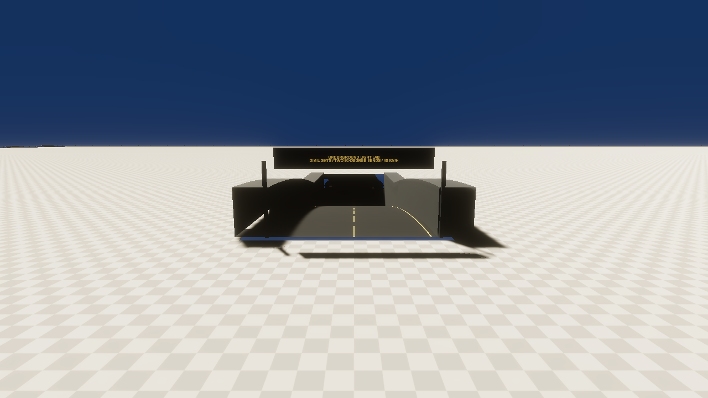
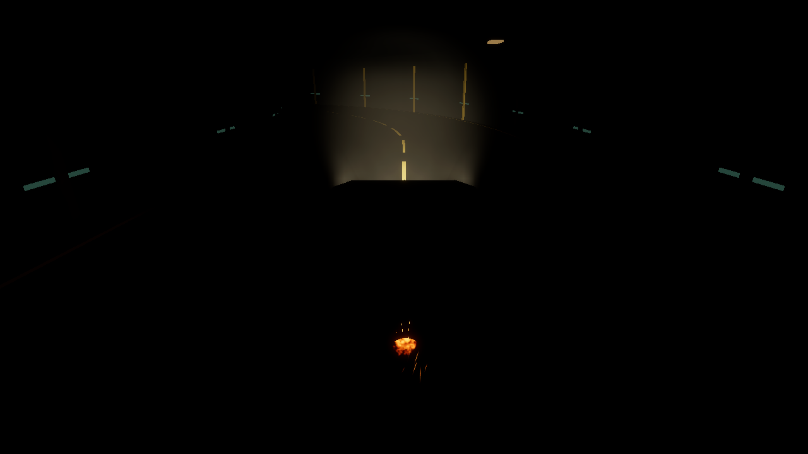
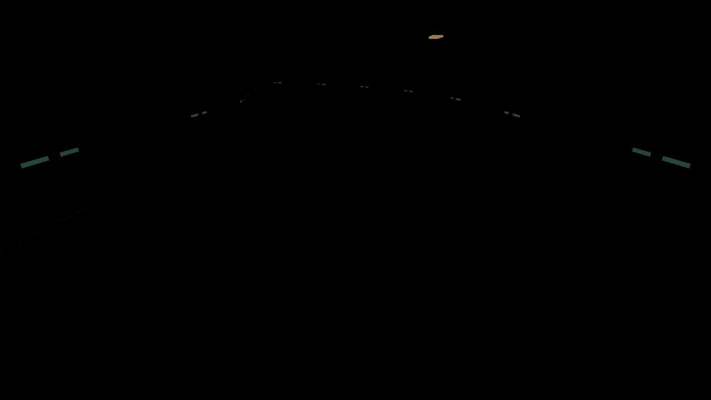

# Underground light lab and camera distances

Maintained on main alongside the intro, pause and existing vehicle features.
Baseline: 39c76a6bed7d7dc0749cfe066727becd7b7aaf6d.
No release workflow, tag or binary publication is added.

## Find the tunnel

From the Tumbler spawn, take the new amber arrows right/east to X=100, then drive
south to the UNDERGROUND LIGHT LAB sign. Portal A is at (100, 0, -40); portal B is
at (242, 0, -40). Either portal can be used in either direction.

The road has two smooth 90 m approach ramps, a -12 m underground level, two
90-degree bends of 32 m centerline radius and an east/west connecting passage.
It is about 460 m long, with 14 m clear width and a 6.5 m arched roof at the center.
Start at low speed; 40 km/h is the signposted test speed, not a calibrated maximum.
The controlled native driving test traverses the complete route at about 18 km/h.

Warm, low-intensity HDRP spot fixtures create separated dim pools. Small subdued
wall markers show the route in stealth. The original vehicle headlights and
stealth state machine are unchanged; L / D-pad Up cycles the lights and V / right
stick click toggles stealth. Local volume profiles lower exposure to EV100 8.5 and
reduce sky/reflection contribution in the covered section. They do not change
the surface's global fixed-exposure profile or the original sun.

## Camera controls and override

| Preset | Center orbit radius | Center height above vehicle origin |
| --- | --- | --- |
| Close (initial) | 5.8 m | 2.2 m |
| Medium | 10 m | 1 m |
| Far | 16 m | 1.6 m |

C / D-pad Down cycles close → medium → far → close. The original Cinemachine
ThreeRing rig, aim, orbit input, recentering, damping and lens remain in use.
All three ring radii are adjusted; changing only its Radius property would not
resize this rig. The close ring heights keep the view above the roof.

SandboxCameraModes stores the selected preset separately from the effective
preset. The vehicle center entering any ramp/tunnel proximity box forces close;
the selected preset stays unchanged. Cycling while inside is ignored. Exiting
either way or teleporting/resetting outside restores the original selection.
Overlapping boxes are evaluated together each frame, so wheel-trigger exits and
segment seams cannot clear the override prematurely. Surface driving above the
buried route does not trigger it. Pause blocks cycling.

Entering the proximity area or teleporting invalidates Cinemachine's old camera
state so the view does not retain a distant position through the tunnel roof.
A vehicle-aware sphere cast shortens the camera offset when a wall/roof/barrier
blocks the view, ignoring the Tumbler's own colliders and trigger volumes.
Disabling the service restores the original orbit settings and clears its override.
The camera action is separate from the existing generated Gameplay wrapper;
all original bindings, action IDs and generated Input.cs remain byte-identical.

## Perimeter and asset preservation

Four continuous 2.2 m containment colliders run around the 1000 × 1000 m platform
at X/Z ±498, with concrete plinths, steel rails and regularly spaced posts.
Corner colliders overlap. These are ordinary physical barriers, not a world
position clamp; jumping over them is still physically possible.

The saved scene adds one instance of UndergroundFacility.prefab. Its only other
edits assign the terrain renderer/collider to TunnelTerrain.asset, a copy of the
original flat TerrainData with two portal openings. The original terrain asset
is preserved. The new road, retaining walls, roof, markers, fixtures, local volumes
and containment are editable prefab assets. The surface above the buried section
remains available. Existing driving-ground fixtures, vehicle geometry, collision
hull, mass/inertia, drivetrain/RPM fix, suspension, grip, input, audio, HUD, intro,
pause and packages are preserved.

The entry ramps are real holes in the terrain collider, not a visual surface
overlay. Continuous floor/wall meshes provide collisions underground. The terrain
openings and road edge retaining walls must be kept together when editing;
disabling the facility alone leaves the terrain openings. To remove the complete
addition, remove its scene instance and restore the original TerrainData reference
on both Terrain and TerrainCollider.

## Repeatable validation

Close this project in Unity, then run the exact Editor:

    python3 tools/sandbox-expansion/run.py FacilityVerify.Run --unity /absolute/path/to/6000.6.7f1/Editor/Unity
    python3 tools/verify-tumbler-update.py --unity /absolute/path/to/6000.6.7f1/Editor/Unity
    python3 tools/verify-navigation.py --unity /absolute/path/to/6000.6.7f1/Editor/Unity

Native HDRP previews:

    python3 tools/sandbox-expansion/run.py FacilityPreview.Run --graphics --unity /absolute/path/to/Editor/Unity
    python3 tools/sandbox-expansion/run.py FacilityPlayPreview.Run --graphics --unity /absolute/path/to/Editor/Unity

Reports and preview PNGs are written to ignored TestResults/SandboxExpansion.
The wrapper temporarily installs Editor-only helpers and restores the dynamic TMP
font asset. Tests never save Sandbox. The authoring Build entry point generates
the prefab/materials/meshes/terrain clone into an absent output folder; it refuses
to overwrite an existing facility. apply-scene.py attaches it using the generated
manifest without reserializing unrelated scene objects. Inspect and explicitly
remove generated output before an intentional rebuild.

The [validation record](sandbox-expansion-validation.json) includes native
road/ramp/roof/wall queries, containment raycasts, six-wheel contact checks on both
ramps and curves, a complete physical drive, close/medium/far restoration, reverse
entry, above-ground exclusion, pause, reset, disabling and actual virtual input
events for C and D-pad Down. Vehicle and intro/pause regressions are recorded
separately from these new checks.

HDRP captures use the actual generated scene and vehicle lights, including real
Play Mode snapshots of lights off/low/high/stealth. Static camera comparison
captures and the portal overview are inspection viewpoints, not timed driving.
Physical controller acceptance, subjective audio/handling, exhaustive fast driving,
performance profiling and standalone player builds remain manual checks.

## Inspecting the result

